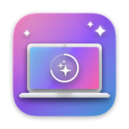

<p align="center">
  
</p>

<h1 align="center">JoClean</h1>

<p align="center">
  A colorful, all-in-one Mac cleaner and malware checker — inspired by CleanMyMac, built natively with SwiftUI.
</p>

<p align="center">
  
  
  
</p>

---

## Features

| Module | What it does |
|---|---|
| **Smart Scan** | Live Disk, Memory, and CPU dashboard plus a one-click scan of system junk and the Trash. |
| **System Junk** | Finds user caches, logs, Xcode DerivedData, iOS DeviceSupport, Simulator caches, and old installers (`.dmg`, `.pkg`, `.xip`). |
| **Trash** | Shows what's in your Trash and empties it permanently. |
| **Large & Old Files** | Sortable table of big or long-untouched files with size and age filters. |
| **Uninstaller** | Removes apps together with their leftovers in `~/Library` and `/Library` — including launch agents/daemons and installer receipts. Root-owned apps are removed via the standard macOS administrator prompt, and vendor-provided uninstallers (e.g. for VPN or security software) can be run with one click. |
| **Optimization** | Lists running apps by memory footprint (Quit / Force Quit) and manages user Launch Agents. |
| **Malware Check** | Combines several detection engines — no account or API key required (see below). |
| **Menu bar** | Quick Disk / Memory / CPU stats from the menu bar. |

### Malware Check engines

| Engine | How it works | Data leaving your Mac |
|---|---|---|
| **XProtect** | Apple's own malware signatures (the YARA rules shipped with macOS), scanned locally with the official [libyara](https://github.com/VirusTotal/yara) engine. | None |
| **Gatekeeper** | Code-signing and Apple notarization check via `spctl` for apps, installers, and disk images. | None |
| **CIRCL hashlookup** | Looks up file hashes in [CIRCL's](https://www.circl.lu/services/hashlookup/) database of known legitimate software (NIST NSRL and more). | SHA-256 hash only |
| **VirusTotal** *(optional)* | 70+ antivirus engines, enabled only if you add your own API key (stored in the Keychain). | SHA-256 hash only |

File contents are never uploaded anywhere.

## Safety first

- Nothing is scanned until you click **Scan**.
- Everything you clean is **moved to the Trash** (except "Empty Trash"), so it can be recovered.
- Every destructive action asks for confirmation.
- Administrator rights are requested only when needed, through macOS's own password dialog — JoClean never sees your password. System folders such as `/Library` or `/Applications` themselves can never be removed.

## Installation

1. Download **JoClean.dmg** from the [latest release](https://github.com/linggameidianza/JoClean/releases/latest).
2. Open the DMG and drag **JoClean** into **Applications**.
3. The app is not notarized yet, so the first time macOS will block it. Open it anyway with one of these:
   - **System Settings → Privacy & Security** → scroll down → **Open Anyway**, or
   - in Terminal: `xattr -dr com.apple.quarantine /Applications/JoClean.app`
4. *(Recommended)* Grant **Full Disk Access** in **System Settings → Privacy & Security → Full Disk Access** so JoClean can read the Trash and every Library folder.

## Building from source

Requirements: **Xcode 26** or later, **macOS 26.6** or later.

```bash
git clone https://github.com/linggameidianza/JoClean.git
cd JoClean
open JoClean.xcodeproj
```

Then press **⌘R**. A prebuilt universal `libyara.a` is included in `ThirdParty/yara/`. To rebuild or update it:

```bash
ThirdParty/yara/build-libyara.sh
```

Run the tests with **⌘U** (unit tests for the detection engines plus UI tests for every module).

## Project structure

```
JoClean/
├── Core/          Shared utilities, theme, system monitor, Keychain, reusable views
├── Features/      One folder per module (SmartScan, SystemJunk, Trash, LargeFiles,
│                  Uninstaller, Optimization, Malware)
ThirdParty/yara/   libyara (BSD-3-Clause) headers, static library, and build script
JoCleanTests/      Unit tests (Swift Testing)
JoCleanUITests/    UI tests (XCUIAutomation)
```

## Notes

- JoClean runs **outside the App Sandbox** because a cleaner needs access to `~/Library`. It's distributed directly, not through the Mac App Store.
- It's intended for personal use.

## Acknowledgements

- [YARA](https://github.com/VirusTotal/yara) by VirusTotal — BSD-3-Clause, see `ThirdParty/yara/LICENSE`.
- [CIRCL hashlookup](https://www.circl.lu/services/hashlookup/) — free public hash lookup service.
- Apple XProtect signatures are read from the copy installed on your Mac and are not redistributed.
